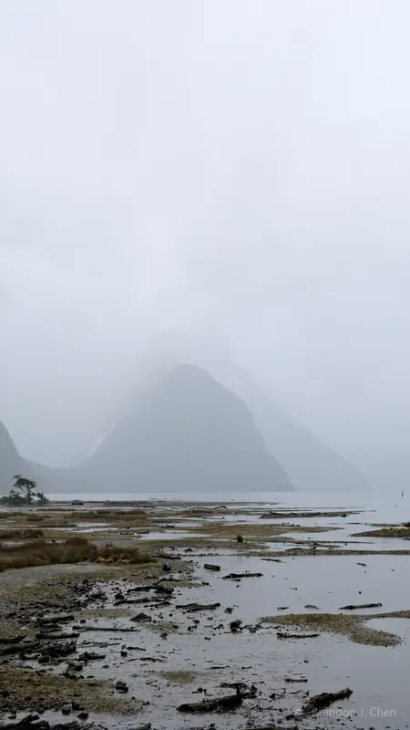

# Portfolio Studio: Python-to-Electron feature-parity review (2026-11-21)

This inventory compares the retired Python/Tkinter implementation preserved at
[`backup/pre-portfolio-studio-20261106`](https://github.com/raisinbran/design/tree/backup/pre-portfolio-studio-20261106/tools/portfolio-studio)
against the current Electron `portfolio-studio/` and this hotfix PR.
**Not every historical behavior should be replicated unchanged:** the new app's published WebP
output and private-original policy are deliberate. Feature parity must be reviewed at the workflow
level rather than judged solely by the number of buttons.

## Restored by this PR

| Workflow | Python feature | Electron hotfix |
| --- | --- | --- |
| Photography order | Four visual strategies plus reverse and manual movement (`arrange_gallery.py`) | `Arrangement` menu with Balanced, Color harmony, Thematic groups, Visual contrast, the newer tag/shape option, and reverse options; manual up/down and locked positions |
| Engineering and Archive order | Buttons to move selected projects and collections (`engineering_editor.py`, `archive_editor.py`) | Up/down controls in each list; existing drag reordering retained |
| Photo import naming | `_crop`, `_edit`, `_fix`, `_small`, custom suffix (`photo_studio.py`) | Same presets and custom input before import, with the actual WebP output name shown |
| Photo management | Remove from repository to system Trash, match renamed publication files (`manage_published.py`) | Rename a catalog entry and its derivative; delete a catalog photo and move unshared public assets to Trash, never the private original |
| Workspace | Independent list/detail navigation | Independent scroll areas for Photography, Engineering and Archive, compact toolbar and centered app header |
| Website | Adequate top/bottom photo-filter spacing; carefully framed homepage previews | Equal top and bottom filter padding; targeted locomotive focal position on Engineering preview |

## Media samples: filenames must disclose actual image format

The new image pipeline outputs **WebP** (up to 800 px on the long side), regardless of the
original's HEIC/JPEG/TIFF file type. The catalog's `file` field is a *source-style identifier*,
not the actual public image filename. The old app typically created a separate public JPEG
plus a WebP thumbnail; this difference remains a deliberate workflow change pending owner review.

| Example | Catalog label | Actual published image |
| --- | --- | --- |
| LAX SkyLink image, source-style name `DSCF4154.heic` | **`DSCF4154_crop.heic`** | **`photography/thumbnails/DSCF4154_crop.webp`** (image bytes unchanged by this rename) |
| Existing landscape image | `DSCF3655_crop.jpg` | `photography/thumbnails/DSCF3655_crop.jpg.webp` (historical filename retained) |
| New `IMG_1001.HEIC` imported using the `_edit` preset | `IMG_1001_edit.HEIC` | `photography/thumbnails/IMG_1001_edit.webp` |

The UI now shows both labels and the WebP preview. Renaming the catalog entry **does not transcode
the binary into HEIC** and does not rename or delete any privately stored original.

## Confirmed remaining parity differences

These are distinct from the hotfixes above and should be triaged before claiming full parity.

| Area | Legacy Python capability (source) | Status in Electron |
| --- | --- | --- |
| Photo publication | Batch selection (current/highlighted/all), staged multi-image publish with conflict numbering (`photo_studio.py`) | **Missing:** one photo at a time; no batch publish/numbered conflict resolution |
| Photo formats | Configurable JPEG quality 80/85/90/95 and max-side size, JPEG for publication + WebP thumbnail (`photo_studio.py`, `processor.py`) | **Different:** only generated 800-px WebP, fixed quality 78; needs explicit owner decision on format/resolution parity |
| Framing | Distinct *Gallery framing* and *Crop exported JPEG* destinations (`photo_studio.py`) | **Missing:** editor crop changes rendered WebP pixels; no separate reversible gallery-only crop |
| Image controls | Horizon/vertical leveling, inspect zoom 100/200/400%, custom width:height crop ratio, full-photo reset (`photo_studio.py`) | **Partial:** rotate, straighten and several crop ratios; no horizon/vertical guides, zoom presets, custom aspect-ratio input |
| Captions | Locally suggested accessible descriptions, reviewed before publish (`photo_studio.py`, `offline_descriptions.py`) | **Missing:** manual descriptions only |
| Pre-publish QA | Detailed publication preview with scope, names, dimensions and overwrite choice (`photo_studio.py`) | **Partial:** render preview and generated filename, but no equivalent batch publication review |
| Existing photos | Add preexisting unlisted publication files, rebuild thumbnails, reconcile missing assets, relink external filename changes (`edit_tags.py`, `manage_published.py`) | **Missing:** imports new originals through Photo Editor; no bulk existing-file reconciliation/rebuild |
| Removal alternatives | Remove gallery entries only; archive published JPEGs to a backup; recycle public files (`manage_published.py`) | **Partial:** unlist or delete public derivative to Trash; no separate archive/recovery catalog action |
| Engineering media | Import/optimize a local image/video into project assets, including unsaved preview (`engineering_editor.py`) | **Missing:** expects repository-relative paths supplied manually |
| Archive media | Import/optimize source artwork, crop/preview before writing (`archive_editor.py`) | **Missing:** expects a path; basic crop mode and aspect ratio metadata exist |
| Engineering content | Preview unsaved draft with asset overrides (`engineering_editor.py`) | **Partial:** browser Preview opens saved page; does not preview unsaved changes |
| UI preferences | Light/dark/system appearance options, dedicated About and saved preferences (`studio_preferences.py`, `studio_about.py`) | **Partial:** technical versions in Settings, but no equivalent appearance chooser or About page |
| Photography review | Reset selected / reset all unsaved, apply gallery-only crop (`edit_tags.py`) | **Partial:** app undo/redo and Reload, but no selection-level reset or gallery-only crop |
| Publication safety | Backup-based multi-file transaction rollback (`photo_studio.py`, `edit_tags.py`) | **Needs hardening:** current `savePortfolio` stages writes and checks revisions but a mid-rename fault can leave an incomplete save |

## Acceptance focus

1. Validate that all five arrangement strategies and their reverse variants preserve locked indexes;
   the full color analysis uses the existing native worker, not renderer-main-thread image decoding.
2. Test rename and delete on a **disposable checkout**. The original photo path and bytes must remain unchanged;
   only site assets and catalog/JS are modified.
3. Verify the filtered/selected list, two independent scrollbars and toolbar fit on Mac and Windows.
4. Check homepage locomotive framing and the Photography sticky filter on narrow and desktop layouts.
5. Confirm the revised naming contract and the WebP derivative are visible *before* importing.
