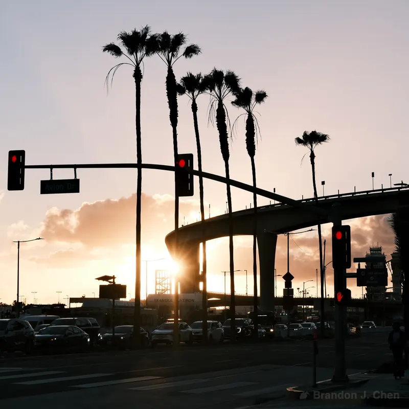

# Portfolio Studio: Python-to-Electron feature-parity review (2026-11-21)

This inventory compares the retired Python/Tkinter implementation preserved at
[`backup/pre-portfolio-studio-20261106`](https://github.com/raisinbran/design/tree/backup/pre-portfolio-studio-20261106/tools/portfolio-studio)
against the current Electron `portfolio-studio/` and this hotfix PR.
**Feature parity is not established.** The original portfolio owner did **not** request automatic
conversion of imported photo filetypes. That change was introduced during the Electron
implementation. PR #22 now exposes the output format plainly and defaults to WebP, but a file
format change must never occur silently. The private-original policy remains mandatory.
Compare actual user workflows, not counts of buttons; [Issue #26](https://github.com/raisinbran/design/issues/26)
requires a comprehensive source-level parity and native acceptance matrix.

## Restored by this PR

| Workflow | Python feature | Electron hotfix |
| --- | --- | --- |
| Photography order | Four visual strategies plus reverse and manual movement (`arrange_gallery.py`) | `Arrangement` menu with Balanced, Color harmony, Thematic groups, Visual contrast, the newer tag/shape option, and reverse options; manual up/down and locked positions |
| Engineering and Archive order | Buttons to move selected projects and collections (`engineering_editor.py`, `archive_editor.py`) | Up/down controls in each list; existing drag reordering retained |
| Photo import and output | `_crop`, `_edit`, `_fix`, `_small`, custom suffix (`photo_studio.py`); Python published JPEG plus a WebP thumbnail | Extension-free Name with suffix presets; adjacent **Output filetype** selector (.webp rec, .jpg, .png); actual website filename shown before saving |
| Photo management | Remove from repository to system Trash, match renamed publication files (`manage_published.py`) | Rename a catalog entry and its derivative; delete a catalog photo and move unshared public assets to Trash, never the private original |
| Workspace | Independent list/detail navigation | Independent scroll areas for Photography, Engineering and Archive, compact toolbar and centered app header |
| Website | Photography display is catalog-driven | Equal top and bottom filter padding; targeted locomotive focal position; **unconditional maximum two photos per row**, regardless of orientation, tags or priority |

## Media samples: filenames must disclose actual image format

**New imports:** the Name field contains only a base name (e.g., `IMG_1001_edit`),
while **Output filetype** controls the actual encoded file extension. Available selections are
`.webp (rec)`, `.jpg` and `.png`. The chosen type appears in the filename,
preview and publication pipeline. Output images remain at most 800 px on the long side.
The Python app had published JPEG and an independently prepared WebP thumbnail, plus size/quality
controls; these are still parity gaps.

**Existing historical entries:** their catalog `file` key may contain a *source-style*
extension even though `thumbnail` points to WebP. Do not rename or recode existing catalog
keys merely to make them look new. HEIC originals remain valid **inputs** to the editor,
but HEIC is not an export option because public browsers lack reliable native support.

| Example | Catalog label | Actual published image |
| --- | --- | --- |
| LAX SkyLink image, source-style name `DSCF4154.heic` | **`DSCF4154_crop.heic`** | **`photography/thumbnails/DSCF4154_crop.webp`** (image bytes unchanged by this rename) |
| Existing landscape image | `DSCF3655_crop.jpg` | `photography/thumbnails/DSCF3655_crop.jpg.webp` (historical filename retained) |
| New `IMG_1001.HEIC` imported using `_edit`, default WebP | `IMG_1001_edit.webp` | `photography/thumbnails/IMG_1001_edit.webp` |
| Same original, with JPEG selected | `IMG_1001_edit.jpg` | `photography/thumbnails/IMG_1001_edit.jpg` |
| Same original, with PNG selected | `IMG_1001_edit.png` | `photography/thumbnails/IMG_1001_edit.png` |

The existing DSCF4154 catalog rename is a **label and WebP asset path change**,
not a HEIC re-encoding. Editing new photos uses the explicitly chosen codec; private originals
remain unchanged. The output formats are WebP, JPG and PNG; HEIC input decoding remains supported.

## Confirmed remaining parity differences

These are distinct from the hotfixes above and should be triaged before claiming full parity.

| Area | Legacy Python capability (source) | Status in Electron |
| --- | --- | --- |
| Photo publication | Batch selection (current/highlighted/all), staged multi-image publish with conflict numbering (`photo_studio.py`) | **Missing:** one photo at a time; no batch publish/numbered conflict resolution |
| Photo formats | Configurable JPEG quality 80/85/90/95 and max-side size, JPEG for publication + WebP thumbnail (`photo_studio.py`, `processor.py`) | **Partial:** selectable WebP/JPEG/PNG output in PR #22, fixed 800 px long-side and fixed quality per codec; original full-size JPEG plus separately framed thumbnail still missing |
| Framing | Distinct *Gallery framing* and *Crop exported JPEG* destinations (`photo_studio.py`) | **Missing:** editor crop changes rendered WebP pixels; no separate reversible gallery-only crop |
| Horizontal/vertical leveling | Draw reference lines with **Level H** / **Level V**, constrained angle correction; Auto-level and Undo rotation (`photo_studio.py`, `photo_viewport.py`) | **Missing:** manual Straighten is not equivalent. **Owner-specified replacement:** Level H/V, Auto-level and **Reset all photo edits**, not a dedicated Undo rotation button; [Issue #23](https://github.com/raisinbran/design/issues/23) |
| Complete ratio controls | Free, Original, 1:1, 3:2, 2:3, 4:3, 3:4, 5:4, 4:5, 16:9, 9:16, Custom; numeric width : height (`photo_studio.py`) | **Missing:** only Free, 1:1, 4:5, 3:2; no Original, portrait/landscape counterparts, or editable ratio fields; [Issue #24](https://github.com/raisinbran/design/issues/24) |
| Composition guides | Grid Off, Thirds, Center, Golden (`photo_viewport.py`) | **Missing:** no non-destructive guide-overlay UI; [Issue #25](https://github.com/raisinbran/design/issues/25) |
| Inspection zoom and pan | 100/200/400% presets, zoom slider, pan mode, mouse-wheel zoom and scrollbars (`photo_viewport.py`) | **Missing:** inspect-zoom / pan workflow. **Owner-specified UI:** no Pan button or separate 200%/400% buttons; default left-drag pans when no tool selected; one 100% button and continuous slider centered on a 100% tick; [Issue #25](https://github.com/raisinbran/design/issues/25) |
| Cropping controls | Full-photo reset, constrain crop edges and drag crop rectangle after rotation (`photo_studio.py`, `photo_viewport.py`) | **Partial:** ReactCrop handles rectangle, but no explicit Full-photo reset and some legacy workflows are absent |
| Captions | Locally suggested accessible descriptions, reviewed before publish (`photo_studio.py`, `offline_descriptions.py`) | **Missing:** manual descriptions only |
| Pre-publish QA | Detailed publication preview with scope, names, dimensions and overwrite choice (`photo_studio.py`) | **Partial:** render preview and generated filename, but no equivalent batch publication review |
| Existing photos | Add preexisting unlisted publication files, rebuild thumbnails, reconcile missing assets, relink external filename changes (`edit_tags.py`, `manage_published.py`) | **Missing:** imports new originals through Photo Editor; no bulk existing-file reconciliation/rebuild |
| Removal alternatives | Remove gallery entries only; archive published JPEGs to a backup; recycle public files (`manage_published.py`) | **Partial:** unlist or delete public derivative to Trash; no separate archive/recovery catalog action |
| Engineering media | Import/optimize a local image/video into project assets, including unsaved preview (`engineering_editor.py`) | **Missing:** expects repository-relative paths supplied manually |
| Archive media | Import/optimize source artwork, crop/preview before writing (`archive_editor.py`) | **Missing:** expects a path; basic crop mode and aspect ratio metadata exist |
| Engineering content | Preview unsaved draft with asset overrides (`engineering_editor.py`) | **Partial:** browser Preview opens saved page; does not preview unsaved changes |
| UI preferences | Light/dark/system appearance options, dedicated About and saved preferences (`studio_preferences.py`, `studio_about.py`) | **Partial:** technical versions in Settings, but no equivalent appearance chooser or About page |
| Photography review | Reset selected / reset all unsaved, apply gallery-only crop (`edit_tags.py`) | **Partial:** app undo/redo and Reload, but no selection-level reset or gallery-only crop |
| Publication safety | Backup-based multi-file transaction rollback (`photo_studio.py`, `edit_tags.py`) | **Needs hardening:** current `savePortfolio` stages writes and checks revisions but a mid-rename fault can leave an incomplete save |

## Aspect controls approved by the owner

Use the current macOS Apple Photos crop-preset set, verified from its Crop UI:
**Original, Freeform, Square, 16:9, 4:5, 5:7, 4:3, 3:5, 3:2, Custom**.
Name the selector **Aspect**, not "Crop ratio". The constant left-to-right order is
**Aspect dropdown → Width → Height → Landscape/Portrait**. The toggle swaps the
active width:height proportion rather than duplicating portrait ratios in the menu.

**Global UI principle: toolbars must never change their dimensions or move controls in
response to a selection.** Aspect, Width, Height, orientation and other toolbar
controls occupy reserved positions at all times. When a preset such as `3:2` is selected
in landscape mode, populate **Width = 3**, **Height = 2**; choosing portrait swaps the
values to **2** and **3**. Original derives the ratio from the oriented source; Square
shows 1:1; Freeform retains the fixed fields but disables their contents. Orientation
is disabled where meaningless without collapsing its space.

Label manual ratio editing **Custom** (not `Custom: 7:5`). If the user edits either
number after selecting a preset, select Custom automatically and validate both
positive finite values before changing the crop. The two inputs always remain
visible and aligned. These are *aspect proportions*, never exported pixel dimensions.

These instructions update the proposal in [Issue #24](https://github.com/raisinbran/design/issues/24);
[view the updated ratio concept](ui-proposals/issue-24-crop-ratios.svg).
The mockup is not evidence of implemented editor functionality.

## Owner-directed deviations from historical controls (2026-11-21)

Feature parity is **behavioral**, not a mandate to duplicate every legacy button:

- **Reset instead of Undo rotation:** Reset reverts all edits applied to the image, including rotation, straightening/leveling, crop and future image transformations. It does not modify the private original or independently alter catalog descriptions, tags, naming, or publication authority. Require confirmation when discarding edits and perform no file writes until Save/Publish.
- **Default panning:** With no editing tool active, left-mouse dragging pans. Crop, Level H and Level V temporarily own left-drag while selected. There is no separate Pan tool.
- **Zoom controls:** Use a compact slider with a 100% tick at the **exact center**; eliminate separate 100% shortcut and 140% current-value controls, as well as the former 200%/400% buttons. A symmetric logarithmic 25%–400% range preserves access to the full zoom range without extra fields.
- **Aspect controls:** The owner approved the Apple Photos preset set, always-visible numeric fields and orientation toggle after Height. Selecting a preset updates the crop preview immediately; do not add a redundant **Apply** button to the primary toolbar.
- **Button hierarchy:** The formerly proposed **Full photo** action clears only the crop, whereas **Reset** discards all photo transformations. To avoid two competing primary commands, remove Full photo from the toolbar and offer the narrower action as **Clear crop** in a fixed-position **More** menu. Reset remains visible with confirmation.
- **Clear active-tool state:** A selected Crop tool is visually distinct through a pressed/high-contrast button and visible crop handles; **do not** add a tutorial strip or **CROP ON** text. Crop, Level H and Level V are mutually exclusive; clicking the current tool again or pressing Esc returns to default left-drag panning. Put usage instructions in Help/manual and concise tooltips.
- **Space allocation:** Exactly **two** fixed-height bars. **TOOLS** contains Crop, Level H/V, Auto-level, rotation, Straighten, **Undo and Redo immediately before Reset**, and More. The combined **ASPECT + VIEW** bar contains Aspect, compact **W** and **H**, the two orientation icons (no “Orientation” label), Grid, and the zoom slider at its right. Both bars have identical external widths and comparable internal content spans (917 px vs 920 px in the reference, well within the 15% tolerance). Zoom takes only the available remaining space. Control positions never reflow in response to selected modes.
- **More menu contents:** **Clear crop** (only crop, unlike Reset); **Show original (hold)** (a proposed non-destructive before/after preview); **Keyboard shortcuts**; **Photo Editor help**. The concept shows this menu expanded below both bars. Shortcut/tutorial instructions belong in the latter help destinations, not an always-visible tutorial banner.
- **Page space:** No oversized heading above the Photo Editor workspace and no “CROP ON” tutorial strip; the two bars begin directly below the shared app/address bar, giving vertical space back to the image viewport. Keep controls navigable and accessible by icon tooltips and assistive labels.

The [integrated future-editor screenshot](ui-proposals/integrated-photo-editor.svg) combines the
only open PR (#22) with the planned but unimplemented features in Issues #23–25. It is a
nonfunctional design illustration, not a photograph of the current app.

The linked UI examples for [leveling and Reset](ui-proposals/issue-23-level-guides.svg)
and [grids with centered zoom](ui-proposals/issue-25-grids-zoom-pan.svg)
are nonfunctional mockups; do not count them as implementation evidence.

## Acceptance focus

1. Validate that all five arrangement strategies and their reverse variants preserve locked indexes;
   the full color analysis uses the existing native worker, not renderer-main-thread image decoding.
2. Test rename and delete on a **disposable checkout**. The original photo path and bytes must remain unchanged;
   only site assets and catalog/JS are modified.
3. Verify the filtered/selected list, two independent scrollbars and toolbar fit on Mac and Windows.
4. Check homepage locomotive framing and the Photography sticky filter on narrow and desktop layouts.
5. Confirm extension-free Name, adjacent output-format selector, and **actual encoded format** in preview and catalog. Test JPEG and PNG output bytes; HEIC originals must still import while HEIC export is rejected.
6. Verify **every rendered gallery row has one or two photos**, including wide desktop screens and filtered galleries.
7. Resolve the parity gaps in Issues [#23](https://github.com/raisinbran/design/issues/23),
   [#24](https://github.com/raisinbran/design/issues/24),
   [#25](https://github.com/raisinbran/design/issues/25) and complete the source-level audit in
   [#26](https://github.com/raisinbran/design/issues/26). Do not claim full parity until accepted.
